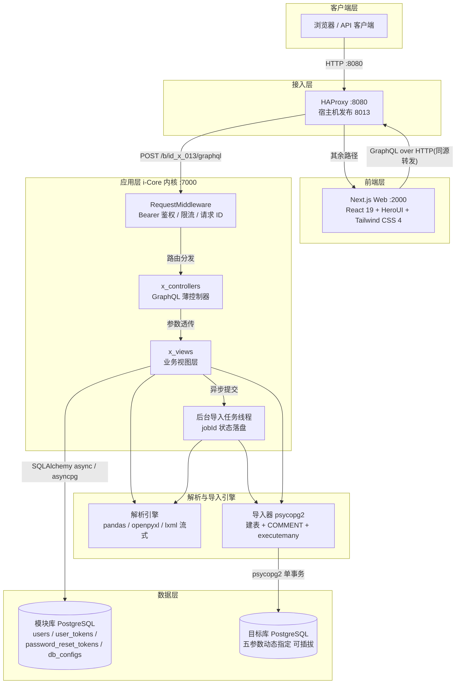
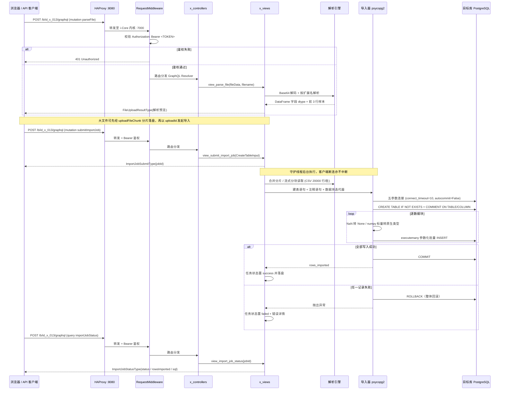

<div align="center">

# id_x_013: IT 标准化数据解析工作台

**上传即入库 —— Excel/CSV/XML 文件解析、PostgreSQL 自动建表与批量导入的一体化工作台**


</div>

---

## 1. 简介 (Introduction)

- **Slogan**: 上传即入库 —— 从数据文件到带注释的数据库表，一条链路直达。
- **Description**: id_x_013 是 **i-Core 平台**的业务插件模块，定位为 IT 标准化数据解析工作台。它解决的核心问题是：散落在 Excel/CSV/XML 文件中的数据资产，入库前通常要经历「人工看结构 → 手写 DDL → 手写导入脚本」的重复劳动。本模块将该流程自动化为一条标准链路：文件上传（支持 Base64 直传与大文件分片上传）→ pandas/lxml 解析预览（字段 dtype 类型推断 + 前 3 行样本值）→ 目标库连接（host/port/username/password/database 五参数动态指定，目标 PostgreSQL 可插拔）→ 自动建表（`CREATE TABLE IF NOT EXISTS` + 表级/字段级 `COMMENT` 同步生成）→ `executemany` 参数化批量导入（单事务执行，任一记录失败整体回滚）。对外仅暴露一个 GraphQL 端点 `/b/id_x_013/graphql`，由 i-Core 内核统一提供 Bearer 鉴权、限流与路由挂载；与通用 ETL 平台相比，它无需编排配置即可完成「文件 → 可查询、带注释的数据库表」的最短路径交付。

## 2. 核心特性 (Features)

- 多格式文件解析：pandas + openpyxl + lxml 解析 `.csv` / `.xlsx` / `.xls` / `.xml` 四类文件，`parseFile` 返回每个字段的 pandas dtype 推断结果与前 3 行样本值，供用户确认后再入库。
- 自动建表与注释同步：按用户确认的字段定义生成 `CREATE TABLE IF NOT EXISTS` 语句，表注释与字段注释以 `COMMENT ON TABLE / COLUMN` 随建表一并写入，响应中回传实际执行的 SQL。
- 目标库五参数可插拔：建表与导入的目标 PostgreSQL 由每次请求的 host/port/username/password/database 五参数动态指定（`connect_timeout=10` 防挂起），并提供 `getDbConfig` 查询 `db_configs` 表中的默认连接配置。
- 单事务批量导入：psycopg2 关闭 autocommit，`executemany` 参数化批量 INSERT，全部成功才 `COMMIT`，任一记录失败即整体 `ROLLBACK`，杜绝半导入脏数据。
- 大文件双通道：小文件走 Base64 `fileData` 直传；大文件经 `uploadFileChunk` 分片落盘、导入时合并，CSV 以 20000 行/批流式读取；`submitImportJob` 后台线程执行 + `importJobStatus` 轮询，彻底避开网关超时。

## 3. 项目亮点 (Highlights)

1. **「解析预览 → 确认 → 入库」的人机确认闭环** —— 不做黑盒导入：先返回字段 dtype 与样本数据，由用户校对字段名、PostgreSQL 类型与中文注释后再触发建表导入，兼顾自动化效率与数据准确性。
2. **后台任务机制对抗网关超时** —— `submitImportJob` 受理后立即返回 `jobId`，导入在独立守护线程 + 独立事件循环中执行，状态以原子写 JSON 落盘（TTL 3600 s），多 worker 进程间共享；即使客户端断连，导入仍继续完成。
3. **pandas 与 PostgreSQL 驱动的类型适配层** —— `NaN` 统一规范化为 `None`、numpy 标量经 `.item()` 转 Python 原生类型，`to_numpy(dtype=object)` 向量化取值替代 `iterrows()`，消除数值类型兼容性陷阱的同时保持导入吞吐。
4. **四层分层架构（薄控制器）** —— controllers 层仅做 GraphQL 参数透传，views 层承载全部业务与异常转换，models 层管 ORM 与会话，schemas 层定义 Strawberry 数据契约；层间职责单一，易测试、易演进。
5. **流式解析支撑超大文件** —— XML 经 lxml `iterparse` 流式解析（内存占用恒定为单条记录，记录标签自动探测），CSV 按 `chunksize` 分批读取；`scripts/transform_xml2csv.py` 另提供面向 20 GB~200 GB 级 XML 的多进程转 CSV 工具。
6. **双模容器编排并存** —— `ops/up.sh` 同 Pod 共享网络命名空间模式与 `ops/compose.yaml` bridge 网络模式双轨提供，四容器拓扑（db / service / web / haproxy）一键拉起，HAProxy 内部监听 :8080、发布至宿主机 8013。
7. **平台安全体系零成本复用** —— 作为 i-Core 插件经 `x_plugin.py` 的 `PluginInterface` 契约接入，Bearer 鉴权、限流、请求 ID、方法白名单均由内核中间件统一提供，模块自身另维护 Token 登录注册体系（`users` / `user_tokens` / `password_reset_tokens` 表）。

## 4. 技术栈 (Tech Stack)

<p align="center">表 4-1 技术栈一览</p>

| 分类 | 名称 | 版本 | 用途 |
|------|------|------|------|
| 编程语言 | Python / TypeScript | ≥ 3.10 / ^5 | 后端插件 / 前端应用 |
| Web 框架 | Litestar（i-Core 内核托管） | — | ASGI 路由与中间件挂载 |
| ASGI 服务器 | Granian | — | 内核进程多 worker 托管（:7000） |
| API 规范 | Strawberry GraphQL | — | 单端点 Query / Mutation |
| 数据解析 | pandas / openpyxl / lxml | — | CSV、Excel 解析 / XML 流式解析 |
| ORM / 数据访问 | SQLAlchemy（async）+ asyncpg | 2.0 | 模块库（users / db_configs 等）异步读写 |
| 导入驱动 | psycopg2 | — | 目标库建表与 executemany 批量导入 |
| 数据库 | PostgreSQL | 18（容器镜像） | 模块库与可插拔目标库 |
| 前端框架 | Next.js + React | 16.2.3 / 19.2.4 | 工作台 Web 界面（:2000） |
| 前端组件 | HeroUI / Tailwind CSS / framer-motion | 3.2.2 / 4 / 12 | 组件库、原子化样式与动效 |
| 反向代理 | HAProxy | 3.0 | 入口 :8080，按路径分流前后端 |
| 容器编排 | Podman / podman-compose | — | 四容器 Pod / compose 双模部署 |

## 5. 整体架构图 (Overall Architecture Diagram)



<p align="center">图 5-1 整体架构图</p>

## 6. 请求流转图 (Request Flow Diagram)



<p align="center">图 6-1 「上传 → 解析预览 → 确认导入 → 自动建表 → 批量写入」请求流转图</p>

## 7. 目录结构 (Directory Structure)

```text
id_x_013/
├── x_plugin.py                  # PluginInterface 插件入口：建表钩子与会话工厂注入
├── __init__.py
├── requirements.txt             # 后端依赖（litestar/strawberry/pandas/lxml/psycopg2 等）
├── .env.template                # 模块级环境变量模板（DB_NAME 与加密连接参数）
├── LICENSE                      # AGPL-3.0 协议文本
├── src/
│   ├── controllers/
│   │   └── x_controllers.py     # GraphQL 薄控制器：Query/Mutation 签名与路由注册
│   ├── views/
│   │   └── x_views.py           # 业务视图层：解析、分片上传、建表导入、后台任务
│   ├── models/
│   │   └── x_models.py          # ORM 模型：users/user_tokens/password_reset_tokens/db_configs
│   ├── schemas/
│   │   └── x_schemas.py         # Strawberry 数据契约：输入/输出类型定义
│   └── parsers/
│       └── xml_parser.py        # lxml iterparse 流式 XML 解析（记录标签自动探测）
├── web/                         # 前端工作台（Next.js 16 + React 19）
│   ├── src/
│   │   ├── app/                 # App Router 页面（/f/login /f/register /f/home 等）
│   │   ├── api/                 # GraphQL/HTTP 客户端（自动附带 Bearer Token）
│   │   ├── components/          # 登录、注册、找回密码等组件
│   │   ├── views/ layout/ utils/ context/
│   │   └── assets/
│   ├── .env.local.example       # NEXT_PUBLIC_BASE_URL / NEXT_PUBLIC_SUB_VERSION
│   ├── next.config.ts           # 根路径重定向至 /f/login
│   ├── Dockerfile               # 前端镜像（dev 端口 2000）
│   └── package.json
├── ops/                         # 容器化运维编排
│   ├── up.sh / down.sh          # 方式一：同 Pod 四容器（共享网络命名空间，8013:8080）
│   ├── compose.yaml             # 方式二：podman-compose bridge 网络模式
│   ├── Dockerfile.service       # 后端镜像（构建上下文为 i-Core 仓库根）
│   ├── haproxy.cfg              # HAProxy 配置（Pod 模式：/b/id_x_013/ → :7000，其余 → :2000）
│   ├── haproxy.compose.cfg      # HAProxy 配置（compose 模式，DNS 服务名互访）
│   ├── .env.example             # 部署环境变量（POSTGRES_* / POD_PORT / DB_HOST_PORT）
│   └── init/                    # 模块库初始化 SQL（01 建表、02 默认连接配置种子）
├── scripts/
│   └── transform_xml2csv.py     # 20GB~200GB 级 XML → CSV 多进程流式转换工具
└── docs/                        # 文档目录
```

## 8. API 接口文档 (API Documentation)

全部接口经由单一 GraphQL 端点暴露，由 i-Core 内核按路由前缀挂载：

```text
POST <BASE_URL>/b/id_x_013/graphql
Content-Type: application/json
Authorization: Bearer <TOKEN>
```

异常码由内核中间件统一返回：`401`（未鉴权）/ `405`（非 GET/POST/OPTIONS 方法）/ `429`（触发限流）；业务级失败不抛 HTTP 异常，统一体现在返回类型的 `success` / `message` 字段中。大文件上传无独立 REST 路由，分片上传同样通过本 GraphQL 端点的 `uploadFileChunk` Mutation 完成。

<p align="center">表 8-1 GraphQL 操作一览</p>

| 类型 | 操作名 | 说明 | 返回类型 |
|------|--------|------|----------|
| Query | `health` | 健康检查 | `HealthType` |
| Query | `getDbConfig` | 获取默认目标库连接配置（`db_configs` 表） | `DbConfigType` |
| Query | `importJobStatus(jobId)` | 轮询后台导入任务状态 | `ImportJobStatusType` |
| Mutation | `login(input)` | 用户登录，签发 24 h Token | `AuthResponseType` |
| Mutation | `register(input)` | 用户注册（待管理员激活） | `AuthResponseType` |
| Mutation | `forgotPassword(input)` | 生成密码重置令牌（1 h 有效） | `ForgotPasswordResponseType` |
| Mutation | `logout` | 用户登出 | `AuthResponseType` |
| Mutation | `parseFile(fileData, filename)` | 解析 Base64 文件，返回字段 dtype 与前 3 行样本 | `FileUploadResultType` |
| Mutation | `uploadFileChunk(uploadId, chunkIndex, totalChunks, chunkData, filename)` | 大文件分片上传落盘 | `ChunkUploadResultType` |
| Mutation | `createTableAndImport(input)` | 同步建表并导入（小文件场景） | `CreateTableResultType` |
| Mutation | `submitImportJob(input)` | 提交后台建表导入任务，立即返回 `jobId` | `ImportJobSubmitType` |

### 8.1 解析文件预览 parseFile

入参：`fileData`（Base64 编码文件内容）、`filename`（原始文件名，按扩展名 `.csv/.xlsx/.xls/.xml` 选择解析器）。出参：`success` / `message` / `fields[]`（`name`、`dtype`、`sampleValues` 前 3 行样本）。

```bash
curl -X POST "<BASE_URL>/b/id_x_013/graphql" \
  -H "Content-Type: application/json" \
  -H "Authorization: Bearer <TOKEN>" \
  -d '{
    "query": "mutation ($fd: String!, $fn: String!) { parseFile(fileData: $fd, filename: $fn) { success message fields { name dtype sampleValues } } }",
    "variables": { "fd": "<BASE64_FILE_DATA>", "fn": "sample.csv" }
  }'
```

### 8.2 提交后台导入任务 submitImportJob

入参 `CreateTableInput`：`tableName`、`tableComment`、`fields[]`（`name` / `dtype`（PostgreSQL 类型，如 INTEGER/TEXT）/ `comment`）、目标库五参数（`host` / `port` / `username` / `password` / `database`）、数据源二选一（`fileData` Base64 直传或 `uploadId` 分片合并）、`filename`。出参：`success` / `message` / `jobId`。

```bash
curl -X POST "<BASE_URL>/b/id_x_013/graphql" \
  -H "Content-Type: application/json" \
  -H "Authorization: Bearer <TOKEN>" \
  -d '{
    "query": "mutation ($in: CreateTableInput!) { submitImportJob(input: $in) { success message jobId } }",
    "variables": { "in": {
      "tableName": "it_assets",
      "tableComment": "IT 资产标准表",
      "fields": [
        { "name": "asset_id", "dtype": "INTEGER", "comment": "资产编号" },
        { "name": "asset_name", "dtype": "TEXT", "comment": "资产名称" }
      ],
      "host": "<TARGET_HOST>", "port": 5432,
      "username": "<TARGET_USER>", "password": "<TARGET_PASSWORD>",
      "database": "<TARGET_DB>",
      "uploadId": "<UPLOAD_ID>", "filename": "assets.csv"
    } }
  }'
```

### 8.3 轮询任务状态 importJobStatus

入参：`jobId`。出参：`status`（`pending` / `running` / `success` / `failed`）、`message`、`rowsImported`、`sql`（实际执行的建表与注释 SQL）、`createdAt` / `finishedAt`。任务结果保留 3600 s，过期返回「任务不存在或已过期」。

```bash
curl -X POST "<BASE_URL>/b/id_x_013/graphql" \
  -H "Content-Type: application/json" \
  -H "Authorization: Bearer <TOKEN>" \
  -d '{
    "query": "query ($id: String!) { importJobStatus(jobId: $id) { status message rowsImported sql finishedAt } }",
    "variables": { "id": "<JOB_ID>" }
  }'
```

同步场景可改用 `createTableAndImport(input)`（入参与 `submitImportJob` 相同），直接返回 `success / message / sql / rowsImported`；大文件建议始终走后台任务通道。

## 9. 快速部署 (Quick Deploy)

### 9.1 环境准备 (Prerequisites)

- Python ≥ 3.10（容器镜像基于 `python:3.10-slim`）
- Node.js ≥ 20 与 npm（本地开发前端时需要）
- PostgreSQL（容器部署内置 `postgres:18`，模块库名默认 `id_x_013`）
- Podman 与 podman-compose（容器化部署）

### 9.2 安装 (Installation)

本模块是 i-Core 平台插件，源码运行时依赖 i-Core 仓库根的内核（`main.py`）：

```bash
# 位于 i-Core 仓库根
pip install -r x_models/id_x_013/requirements.txt

# 模块级环境变量（DB_NAME 与加密的 DB_HOST/DB_PORT/DB_USERNAME/DB_PASSWORD，
# 加密值用内核 utils/encrypt_util.py 生成）
cp x_models/id_x_013/.env.template x_models/id_x_013/.env

# 前端依赖
cd x_models/id_x_013/web && npm install
cp .env.local.example .env.local   # NEXT_PUBLIC_SUB_VERSION=/b/id_x_013/graphql
```

### 9.3 运行 (Run)

```bash
# 1) 在 i-Core 的 config/base_config.toml [EXTEND].MODELS 中声明本模块后，启动内核（:7000）
python main.py

# 2) 启动前端开发服务器（:2000）
cd x_models/id_x_013/web && npm run dev
```

内核启动后经 `x_plugin.py` 自动建表并注入会话工厂；GraphQL 端点位于 `http://127.0.0.1:7000/b/id_x_013/graphql`。

### 9.4 容器部署 (Container Deploy)

两种方式均在 `ops/` 目录执行，先准备部署环境变量：

```bash
cd x_models/id_x_013/ops
cp .env.example .env    # 务必修改 POSTGRES_PASSWORD；POD_PORT 默认 8013
```

方式一：同 Pod 四容器（db / service / web / haproxy 共享网络命名空间）：

```bash
./up.sh --build         # 构建镜像并启动（宿主机端口 8013 → Pod 内 HAProxy :8080）
./down.sh               # 停止并移除容器（保留数据卷）
```

方式二：podman-compose bridge 网络模式（额外将模块库 5432 发布到宿主机 `DB_HOST_PORT`，默认 54323）：

```bash
podman-compose up -d --build
podman-compose down
```

两种方式请勿混用（容器命名不同，混用会造成端口冲突）。部署完成后由 HAProxy 统一入口访问：`/b/id_x_013/` 前缀转发后端 service（:7000），其余路径转发前端 web（:2000）：

```text
http://<HOST>:8013/                      # 前端工作台（重定向至 /f/login）
http://<HOST>:8013/b/id_x_013/graphql    # GraphQL 端点
```
